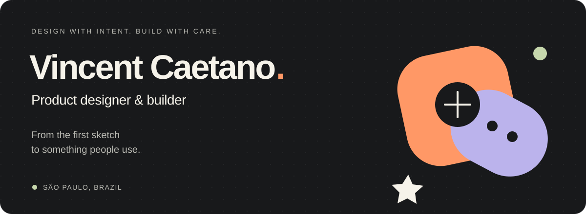

  <a href="https://caetanovincent.com/"><strong>Portfolio ↗</strong></a>
  &nbsp;&nbsp;·&nbsp;&nbsp;
  <a href="https://www.linkedin.com/in/vincent-endryls/">LinkedIn</a>
  &nbsp;&nbsp;·&nbsp;&nbsp;
  <a href="https://peerlist.io/caetano">Peerlist</a>

 

### Hey, I'm Vincent.

I'm a **UX/UI product designer based in São Paulo, Brazil**, with 5+ years creating web and mobile products. I work across usability, design systems, and data-informed decisions — and I like taking ideas beyond the mockup.

Here you'll find the things I build: native macOS tools, reusable design assets, and experiments that turn a small frustration into something useful.

### Design mindset. Builder's curiosity.

| Product & design | Hands-on building |
| :--- | :--- |
| Usable flows, thoughtful interactions, and clear interfaces | Native macOS apps with Swift and SwiftUI |
| Design systems that make consistency easier | Small tools that solve everyday problems |
| Decisions informed by how people actually use a product | Reusable assets with documentation and examples |

### A few things I've made

**[Squishy · Media Manager ↗](https://github.com/vincent-caetano/Squishy-Media-Manager)** 
A native macOS tool for converting and compressing video, audio, and images. Drop in your files, choose an output, and let the queue do the work. 
Swift · macOS · FFmpeg

**[Soundboard for macOS ↗](https://github.com/vincent-caetano/soundboard-for-macos)** 
A menu bar soundboard with global hotkeys, waveform trimming, and audio routing. Built for playing sounds without interrupting what you're doing. 
SwiftUI · AVFoundation · CoreAudio

**[Brazilian State Flags ↗](https://github.com/vincent-caetano/tweemoji-brazil-state-flags)** 
27 Twemoji-inspired Brazilian state flags, with editable SVGs, transparent PNGs, typed metadata, and React Native examples. 
Design assets · SVG · React Native

 

---

  <strong>Have something worth building?</strong> 
  <a href="https://caetanovincent.com/">Explore my work</a> or <a href="https://www.linkedin.com/in/vincent-endryls/">let's connect</a>.

