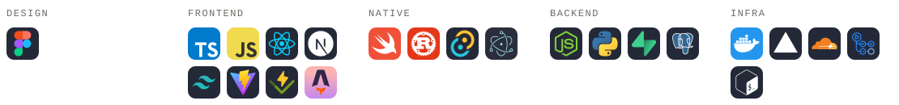

  <a href="https://caetanovincent.com/"><strong>Portfolio ↗</strong></a>
  &nbsp;&nbsp;·&nbsp;&nbsp;
  <a href="https://www.linkedin.com/in/vincent-endryls/">LinkedIn</a>
  &nbsp;&nbsp;·&nbsp;&nbsp;
  <a href="https://peerlist.io/caetano">Peerlist</a>

### Skills

